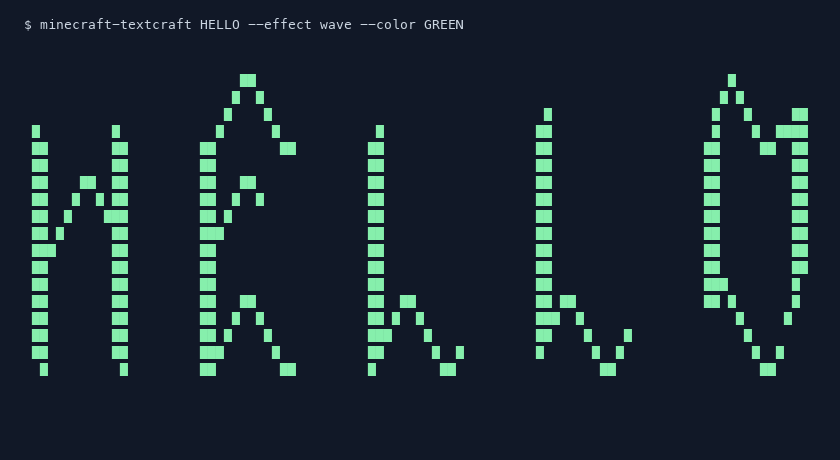

# Minecraft Textcraft

**A Python package and CLI for block-letter ASCII art, themed icons, color and terminal animation.**

[](https://github.com/swe-students-fall2025/3-python-package-brio/actions/workflows/ci.yml)
[](https://github.com/swe-students-fall2025/3-python-package-brio/actions/workflows/cd.yml)

Textcraft turns plain text into Minecraft-inspired terminal graphics. Users can insert item art such as a sword or shield, choose a color, and play typewriter, scrolling or wave effects from one command.



## Engineering highlights

| Capability | Evidence in the repository |
| --- | --- |
| Modular Python design | Separate rendering, command lookup, color and animation modules in [src/minecraft_textcraft](src/minecraft_textcraft/) |
| CLI design | An argparse entry point with discoverable help, item listing, validation and error handling |
| Packaging | [pyproject.toml](pyproject.toml) defines the installable package and console entry point |
| Automated checks | [tests](tests/) cover command handling, animation and CLI behavior |
| Release automation | GitHub Actions builds and publishes a distribution to PyPI when a v-prefixed tag is pushed |

This was a team project for NYU Software Engineering, Fall 2025. These capabilities describe the shared implementation; see [contributors](https://github.com/swe-students-fall2025/3-python-package-brio/graphs/contributors) and commit history for attribution.

## Install and try

Use Python 3.11+ for the development commands below.

```bash
pip install minecraft-textcraft
minecraft-textcraft --help
minecraft-textcraft HELLO --color GREEN
minecraft-textcraft --get sword
minecraft-textcraft HELLO --effect wave --color GREEN --fps 12
```

The published package and the source checkout can differ. To review this implementation, install from source using the next section.

| Option | Purpose |
| --- | --- |
| `text` | Text to render; defaults to HELLO |
| `--get NAME` | Print one themed item, such as sword |
| `--list` / `--list-commands` | List available item commands |
| `--list-categories` | List item categories |
| `--color` | RED, GREEN, YELLOW or BLUE |
| `--effect` | type, scroll or wave |
| `--fps` | Animation playback rate; default 12 |

Use a monospace terminal with Unicode block-character support. Press Ctrl+C to stop playback. See [DEMO_COMMANDS.md](DEMO_COMMANDS.md) for inline item syntax and examples.

## Develop and test

```bash
git clone https://github.com/swe-students-fall2025/3-python-package-brio.git
cd 3-python-package-brio
python3 -m venv .venv
source .venv/bin/activate
python -m pip install -e '.[dev]'
python -m pytest tests
python -m build
```

On Windows, activate with `.venv/Scripts/activate`. The current default branch is `pipfile-experiment`; cloning without a branch option checks out that branch.

## How it works

```text
CLI input -> argument parsing -> text/item lookup -> block-art rendering
                                                -> color/animation -> terminal
```

For interview discussion, start with how the CLI composes these modules, how terminal rendering is tested without an interactive terminal, and how package releases are separated from development.

The GIF renders actual frames from the package's wave-animation function into an image for GitHub; it is a visual export of program output.

[Course instructions](instructions.md) · [License](LICENSE)
